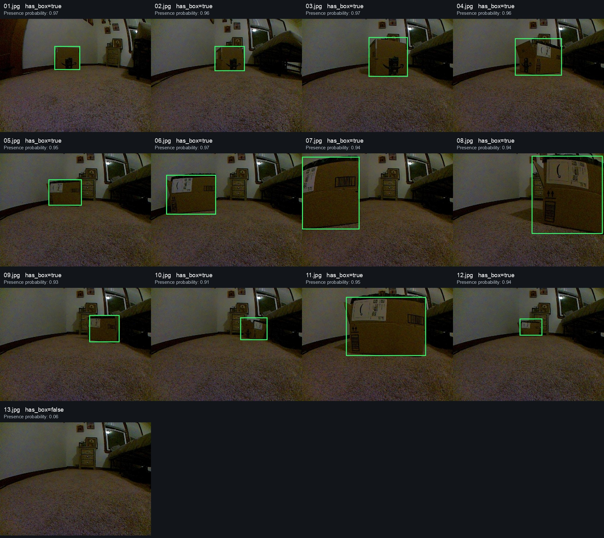
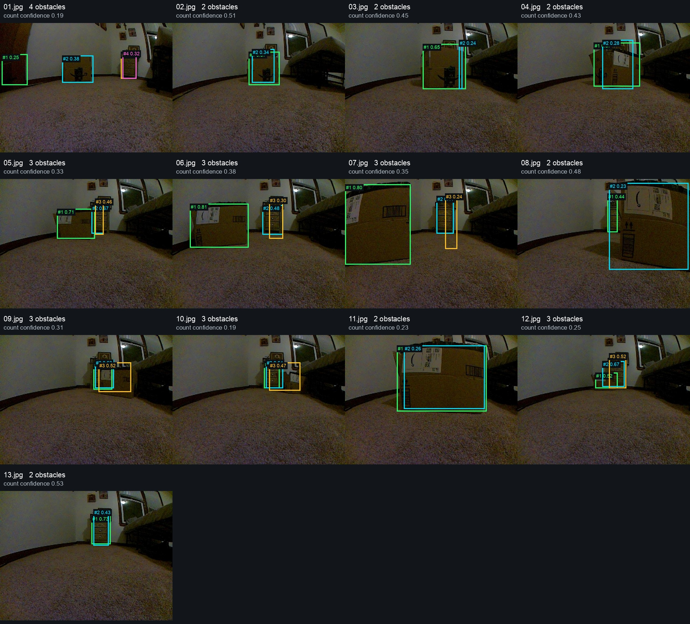

# Jev as a PiCar obstacle-detection candidate

**Status:** candidate. **Disposition:** plausible, parked on 2026-10-18.

Retain Jev as a plausible PiCar obstacle-detection method. Continue development
in simulation. Revisit physical-perception refinement once a plausible movement
preset exists; no further tuning or promotion is planned before that point.

Two experimental plugins implement agent-free inference through the hosted Jev
1.14 API. Each frame uses fixed questions; Jev supplies the coordinates, and
ordinary plugin code validates and publishes them:

- [`jev_cardboard_box`](../../implementations/decision_cycle/perception/plugins/jev_cardboard_box/README.md)
  asks whether a cardboard shipping box is present and where it is.
- [`jev_discrete_obstacles`](../../implementations/decision_cycle/perception/plugins/jev_discrete_obstacles/README.md)
  frames the image as an eye-level camera and asks for distinct physical
  obstacles that would impede movement. A count question selects up to six
  independently requested boxes in left-to-right order. The eye-level framing
  is a prompt assumption, not a measured camera pose.

## Evidence retained

CLI replay used all 13 physical captures from
`lab/runs/picar-stills-20261017`, plus 12 archived simulator captures for the
cardboard comparison. Timings include image preparation and the remote request
on the development Mac. They exclude acquisition on the Pi, camera transport,
and downstream movement; no live Pi inference or autonomous driving was tested.

| Method and source | Result | Median | p95 |
| --- | --- | ---: | ---: |
| Jev cardboard, physical stills | 12/12 boxes detected, empty scene correctly rejected on five passes | 90.3 ms | 149.3 ms |
| Simulator CV, simulator stills | 11/11 boxes detected, empty scene correctly rejected on five passes | 26.6 ms | 31.8 ms |
| Jev cardboard, simulator stills | 9/11 boxes detected; two extreme close-ups missed | 91.4 ms | 144.0 ms |
| Jev discrete obstacles, physical stills | 2–4 boxes per image; frequent duplicate boxes and low confidence | 104.8 ms | 145.7 ms |

The class-specific result makes Jev promising on these captures. It does not
establish simulator latency parity or general obstacle-detection reliability.
Repeated passes are repeatability evidence, not independent scenes. Approximate
visual reference boxes used for overlap diagnostics were not provided to Jev.

The following stitches render Jev's returned coordinates without manual box
adjustments. The broader version preserves overlapping and low-confidence boxes
selected by Jev's count; unused speculative slots are retained in the raw data.





- [Cardboard benchmark summary](assets/jev-picar-20261018/cardboard-summary.json)
  and [per-frame measurements](assets/jev-picar-20261018/cardboard-frames.csv).
- [Eye-level prompt](assets/jev-picar-20261018/eye-level-prompt.json),
  [summary](assets/jev-picar-20261018/eye-level-summary.json),
  [emitted boxes](assets/jev-picar-20261018/eye-level-boxes.csv), and
  [raw responses](assets/jev-picar-20261018/eye-level-responses.json).

Original captures and complete CLI recordings remain local under `lab/runs/`
and `runtime/perception-inspections/`. The retained summaries include input
hashes. No API credentials are saved in this branch.

## Revisit condition

Once simulation has a plausible movement preset, assess whether its perception
needs map to Jev's output. Then measure real Pi-to-decision latency and test
missed obstacles, duplicate boxes, and multi-object consistency against that
preset's movement requirements. Keep the current evidence as a baseline rather
than tuning against this small capture set now.

To replay locally, provide `JEV_API_KEY` or `TYPESAFE_API_KEY` through the
environment and select either plugin:

```sh
.venv/bin/python cli/automa vehicles perception inspect \
  lab/runs/picar-stills-20261017 \
  --plugin jev_cardboard_box --record --json

.venv/bin/python cli/automa vehicles perception inspect \
  lab/runs/picar-stills-20261017 \
  --plugin jev_discrete_obstacles --record --json
```

This branch is a parked experiment. Both plugins remain opt-in; the existing
perception presets are unchanged.
